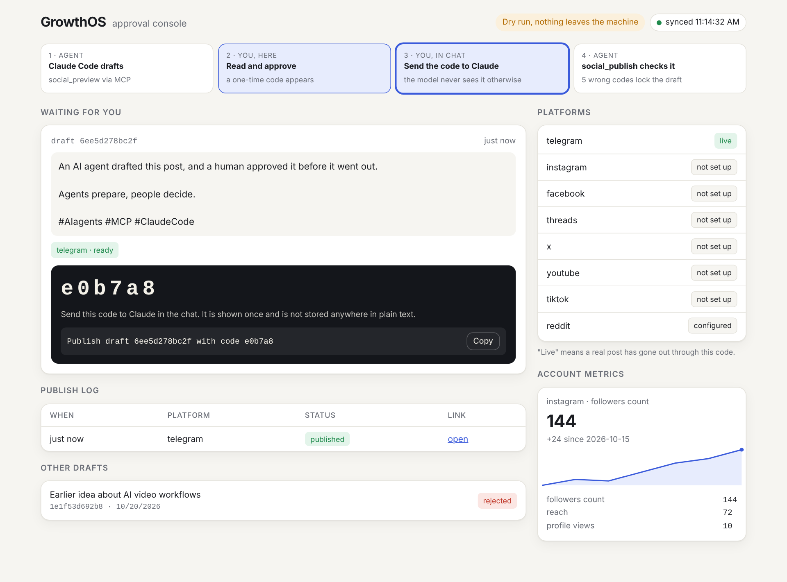

# GrowthOS

An MCP server that lets Claude Code prepare, review and publish social posts, plus an approval
console where a human decides. Two independent locks sit between the model and your audience.

```text
you ask Claude Code for a post
  → social_preview   validates it per platform and stores an immutable draft, pending.
                     No code is returned: the model never sees one.
  → the console      you read the draft in the browser and press Approve;
                     a one-time code appears there, only its hash is stored
  → you              send that code to Claude in the chat
  → social_publish   publishes exactly that draft, and only with a matching code
```

Nothing leaves the machine unless `GROWTHOS_ALLOW_PUBLISH=1`. The approval code is separate from
that switch on purpose: the switch can stay on for a working session while the code still forces a
human decision for each post. A real publish burns the code; a dry run does not.

## Why the locks

An agent that can post is an agent that can post something you did not want, from an account people
associate with you. The usual answer is an instruction in the tool description — "only call this
after the user approves". That is a convention, not a mechanism: the model is free to decide it has
approval.

Here the approval is a value the model does not possess until a human hands it over.
`social_preview` returns no code at all. The code is generated only when a person presses
Approve in the console, shown in the browser once, and stored as a SHA-256 hash. `social_publish`
takes the code as a required argument and refuses without a match. The MCP schema shows it:

```text
social_publish   required=['draft_id', 'approval_code']
```

Five wrong codes lock the draft, so the six-character code cannot be guessed by retrying. A new
preview of the same content needs a new decision, and a rejected draft cannot be published.

**The honest limit.** Earlier versions returned the code inside the `social_preview` result, the
same text the model reads, so the lock relied on the model choosing not to use it. The console
moves the code out of the model's context. It does not make the machine a security boundary: a
process with full shell access to your account could still reach the console or your terminal.
Real separation needs a second device, for example approving on a phone, and that is the next step.

## Approval console

```bash
python -m growthos.console          # from the repository root; opens http://127.0.0.1:8765
```



*Screenshot with sample data, in dry-run mode.*

One page: drafts waiting for you (text, media, per-platform checks, Approve / Reject), the publish
log, which platforms are configured and which have gone live, and the collected account metrics.
It refreshes every few seconds, so a draft Claude prepares appears while you watch. The server
binds to 127.0.0.1 only and every API call needs a session key generated at start-up, printed once
in the terminal and never written to disk. No extra dependencies: Starlette and uvicorn come with
`mcp`.

## Platforms

| Platform | Publishing | Metrics | Notes |
|---|---|---|---|
| Telegram | ✅ verified live | — | channel or chat; bot must be an admin |
| Instagram | ✅ verified live | snapshot | Professional account; media must be a public URL; video posts as a Reel |
| Facebook Page | adapter written, untested | — | needs a Page token |
| Threads | adapter written, untested | — | same Meta app as Instagram |
| X | adapter written, untested | snapshot | paid tier |
| YouTube | adapter written, untested | — | uploads stay private until Google audits the project |
| TikTok | adapter written, untested | — | lands in the app's inbox as a draft; public posting needs review |
| Reddit | assisted | — | returns a prefilled submit link for a human to post |

"Verified live" means a real post went out through this code. The rest pass unit tests against
mocked HTTP and have never seen a credential. The difference matters, so it is stated rather than
blurred.

## What is not built

Metrics are fetched as a snapshot and stored nowhere, so "which post worked" has no answer yet.
There is no scheduling, no reporting, and media has to be a public HTTPS URL rather than a local
file. The plan, in order, is in [docs/plans/2026-10-01-growthos-social-status.md](docs/plans/2026-10-01-growthos-social-status.md).

## Quick start

```bash
git clone https://github.com/swd07/growthos && cd growthos
python -m venv .venv && .venv/bin/pip install -r growthos/requirements.txt
cp .env.social.example .env.social     # fill in one platform; Telegram takes ~10 minutes
claude                                  # Claude Code picks up .mcp.json
```

On Windows `python3` in `.mcp.json` is usually the Microsoft Store stub — point the command at
`.venv\Scripts\python.exe` locally. Per-platform credentials are walked through in
[docs/setup/social-accounts.md](docs/setup/social-accounts.md), and the provider contract is in
[docs/specs/social-provider-interface.md](docs/specs/social-provider-interface.md).

```bash
.venv/bin/python -m pytest growthos/tests -q     # 28 tests
```

## State

Secrets live in `.env.social`, which is git-ignored; nothing in this repository holds a credential.
Drafts, approval-code hashes and the publish log live in `~/.growthos/`, written as utf-8 and
replaced atomically so a failed write cannot destroy them.

## License

No license yet — all rights reserved. Open an issue if you want to use it.
